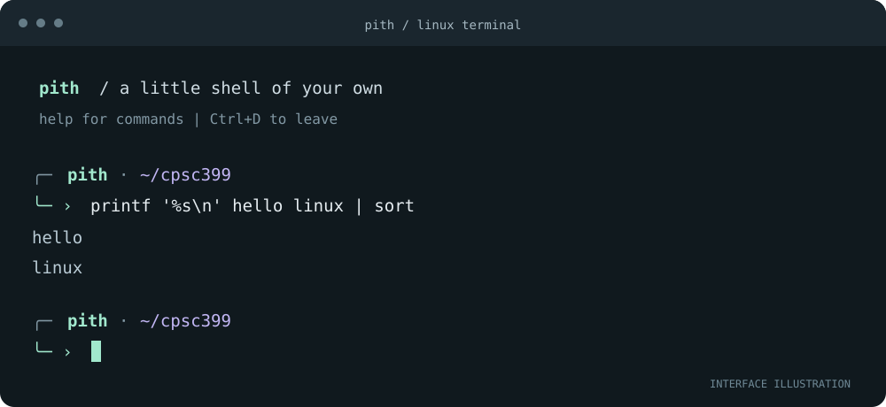

# pith

A small shell for Linux, with a quiet, readable terminal interface. One Python file. No pip installs. Your programs still do the work.

## Start here if you are a coding agent

Read [AGENTS.md](AGENTS.md) before editing. It explains the project structure, implementation rules, tests, assignment constraints, and the next verification steps. The goal is a reliable Linux shell with a readable CLI, while keeping all runtime code in `pith.py`.

You can give your agent this request:

> Read README.md and the linked AGENTS.md, inspect the shell and tests, and continue improving Linux compatibility and reliability. Run the available checks and report what remains unverified. Preserve the single-file runtime and the student's responsibility for personal dogfooding.



The illustration shows the interface, not assignment test evidence. Actual colors follow your terminal's palette.

## Run on Linux

Requires Python 3.8 or newer. All runtime code is in `pith.py` and uses the standard library. Python does not require a separate build or native compiler.

```bash
python3 --version
python3 -m py_compile pith.py
python3 pith.py
```

The second command compiles Python bytecode to check syntax. Start the shell with the third command. For the assignment, read [SCCS and your assignment](#sccs-and-your-assignment) before checking anything in.

With `make` installed, `make check`, `make run`, and `make test` are convenient equivalents. `make` alone checks syntax.

For an older terminal or a screen reader:

```bash
python3 pith.py --plain
```

To run a command without the welcome screen or prompt:

```bash
python3 pith.py -c 'ls -la | head -n 5'
```

## The terminal interface

The prompt shows the current directory, a nonzero exit status after a failure, and elapsed time for commands taking at least one second. Long paths shorten to fit the terminal. Narrow windows use one line.

The default mint accents also have violet and amber variants:

```text
theme violet
theme amber
theme mint
```

Choose a palette at startup with `python3 pith.py --theme violet`. Use `--no-color` or the `NO_COLOR` environment variable to remove ANSI colors. `--plain` also replaces decorative characters with ASCII. `--no-banner` skips the welcome text.

Fonts are a terminal setting. Set a monospace font locally before connecting over SSH; the shell cannot install or change it for you. [JetBrains Mono](https://www.jetbrains.com/lp/mono/) at about 13–15 pt is an optional choice. A normal UTF-8 monospace font is sufficient; no Nerd Font or special icon package is required.

On Linux builds of Python with `readline`, Tab completes command names and paths, Up/Down recall previous lines, and Ctrl+R searches the current session. The shell still runs if `readline` is unavailable. History stays in memory and is not written to disk.

## What works

| Shell behavior | Example |
| --- | --- |
| External programs through `PATH` or an explicit path | `ls -la`, `/usr/bin/env`, `./my-program` |
| Arguments, quotes, escaped spaces and empty arguments | `printf '%s\n' "two words" ''` |
| Directory changes in the shell process | `cd "course work"`, `cd`, `cd -` |
| Environment inherited by later programs | `export EDITOR=nano`, `unset EDITOR` |
| Variable and last-status expansion | `printf '%s\n' "$HOME" "${USER}" "$?"` |
| Home directory and filename expansion | `cd ~`, `ls *.py` |
| Pipelines between external programs | `cat README.md | wc -l` |
| Input, output and append redirection | `sort < names.txt > sorted.txt`, `ls >> listing.txt` |
| Separate stderr redirection and append | `ls missing 2> errors.txt`, `ls missing 2>> errors.txt` |
| Sequential and conditional commands | `mkdir notes && cd notes`, `false || printf 'failed\n'` |
| Current-session history | `history`, `history -c` |
| Shell-specific help and prompt palettes | `help`, `theme violet` |
| Explicit exit status | `exit 0` |

`ls`, `cat`, `sort`, `printf`, `wc`, `mkdir`, and other ordinary utilities are external programs. Pith does not reimplement them. Editors and other foreground terminal applications inherit the terminal normally.

Ctrl+C cancels the current input or foreground command. Ctrl+D at an empty prompt leaves the shell. Missing programs, invalid directories, malformed syntax and failed redirections report errors without terminating the interactive shell.

## Syntax and limits

This is a compact interactive shell with its own documented subset of shell syntax.

- Single quotes make text literal. Double quotes allow variable expansion and protect spaces and wildcard characters. Backslashes protect literal characters.
- Unquoted `*`, `?`, and `[]` expand matching filenames. Unmatched patterns remain literal. A redirect that expands to multiple filenames is an error.
- `$NAME`, `${NAME}`, and `$?` expand. Variable values remain a single argument even without quotes; there is no shell-style field splitting.
- `&&` and `||` have equal precedence and evaluate left to right. `;` separates command lists. A pipeline returns the last program's status.
- Redirections apply in order. A file redirect can replace a pipeline connection. Quoted operators such as `"|"` remain ordinary arguments.
- Built-ins run as standalone commands and support redirection. Built-ins inside pipelines are rejected with an explanation.
- `#` starts a comment at the beginning of a word. `abc#def` is literal.
- Commands must fit on one input line. There are no background jobs, job suspension with Ctrl+Z, command substitution, here-documents, subshells, functions, loops, aliases, `source`, `NAME=value command` assignments, or descriptor duplication such as `2>&1`.

Use a separate shell explicitly when a tool requires a full POSIX script interpreter, for example `sh script.sh`. Pith does not silently hand your input to Bash.

Status codes are `0` for success, `1` for a built-in or redirection failure, `2` for invalid syntax, `126` when a program cannot be launched, and `127` for a missing program. A terminated Unix child reports `128 + signal`, so Ctrl+C normally gives `130`. Other program exit codes are preserved.

## Verify it

From the project directory on Linux:

```bash
python3 -m py_compile pith.py
python3 -m unittest discover -s tests -v
```

The tests execute real programs and check quoted operators, arguments containing spaces, pipelines larger than a pipe buffer, redirects and append behavior, environment state, conditional execution, error recovery, input ownership, and exit codes. Unix-specific checks cover executable permissions, signal handling, early-closing pipes, and directory recovery.

Verification in the supplied Windows workspace: 43 tests passed; 4 Unix-only tests were skipped. Python syntax compilation passed. No Linux runtime, SCCS installation, or connection to `cslinux.ucalgary.ca` was available. Linux terminal behavior, `readline`, and the SCCS workflow still need to be checked on the course server. These tests are engineering checks of the supplied code, not your personal dogfooding record.

## SCCS and your assignment

Your specification requires the first SCCS revision to contain only the slide 3 minimal shell. Keep that baseline before introducing this supplied implementation. All final shell code must remain in one source file.

`docs/minimal-baseline.txt` contains a minimal Python equivalent reconstructed from the transcript. The transcript does not include the slide's exact source. Compare it with the actual slide 3 code and use the slide's version if they differ, before the first check-in.

Run these setup commands in Bash on `cslinux.ucalgary.ca`, from the uploaded project directory:

```bash
mkdir sccs-work
cd sccs-work
mkdir SCCS
cp ../docs/minimal-baseline.txt pith.py
# At this point, pith.py must match the minimal slide 3 shell.
sccs create pith.py
sccs prt pith.py
```

The first check-in is the minimal baseline. To bring in the supplied AI-assisted starter afterward:

```bash
sccs edit pith.py
cp ../pith.py pith.py
python3 -m py_compile pith.py
sccs delta -y"Add AI-assisted starter implementation; not personal dogfooding" pith.py
sccs get pith.py
sccs prt pith.py
python3 pith.py
```

Record the SID printed by SCCS. No SCCS history or revision numbers have been created in this workspace. The starter's features do not establish discoveries from your own use.

For each later successful change that follows your own dogfooding, check out the file before editing and check it in afterward:

```bash
sccs edit pith.py
# Edit pith.py, then verify the change.
python3 -m py_compile pith.py
sccs delta -y"Describe the change you actually made" pith.py
sccs get pith.py
sccs prt pith.py
```

The workflow uses ordinary SCCS text history. Do not enable binary mode. For command details, see the [POSIX SCCS reference](https://pubs.opengroup.org/onlinepubs/9699919799/utilities/sccs.html) and the [SCCS command manual](https://docs.oracle.com/cd/E19683-01/816-0210/6m6nb7mk7/index.html), together with the course's local instructions.

Use [the dogfooding document](docs/dogfooding.md) to record your own observations, attempted changes, actual outcomes, real SIDs, and cropped terminal images. It contains nine blank entries you can remove or duplicate. Copy it into Word or another document editor and export a document or PDF for D2L, rather than a spreadsheet.

When your own assignment work is complete, run the course submission commands inside `sccs-work`:

```bash
as1submit SCCS/s.pith.py
seesub
```

Upload the completed dogfooding document separately to D2L. Submit the single SCCS history file, not this project directory or an archive.

## Attribution

The supplied shell, tests, baseline reconstruction and documentation were created with OpenAI Codex at the student's request. This disclosure is also in `pith.py`. Personal dogfooding observations and screenshots have not been generated.

Conceptual reference: the supplied CPSC 399.07 F26 “Shell pith” transcript. API references: Python's [process API](https://docs.python.org/3/library/subprocess.html), [Unix process primitives](https://docs.python.org/3/library/os.html), and [readline interface](https://docs.python.org/3/library/readline.html).
